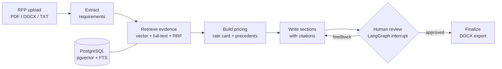

# RFP Proposal Writer

**An agentic LLM workflow that reads a Request for Proposal, retrieves evidence from past documents, drafts a priced proposal with citations, and pauses for human review.**

[](https://github.com/ahsaan-10/RFP-Proposal-Writer/actions/workflows/tests.yml)


[](LICENSE)

[Live interface](https://rfp-proposal-writer-dusky.vercel.app) · [Architecture](docs/architecture.md) · [Deployment guide](docs/DEPLOY.md)

---

## Why this matters

Responding to an RFP means reading dozens of requirements, digging up relevant past work, building a price, and making sure every claim is backed by evidence. This project turns that into one reviewable pipeline: the model does the drafting, retrieval keeps it grounded in real documents, and a human approves before anything is exported.

## Key features

| Feature | How it works |
| --- | --- |
| **Requirement extraction** | Parses PDF, DOCX, or TXT and extracts structured requirements as JSON. |
| **Hybrid retrieval (RAG)** | Combines pgvector semantic search with PostgreSQL full-text search, merged by reciprocal rank fusion; optional Cohere reranking. |
| **Pricing drafts** | Builds a price from a configurable rate card, pricing rules, and retrieved precedents. |
| **Cited writing** | Drafts each proposal section with citation references, then runs an LLM citation audit. |
| **Human in the loop** | The LangGraph workflow interrupts for review; rejecting with feedback sends it back to drafting. |
| **DOCX export** | Produces an editable Word proposal. |
| **Configurable, not hard-coded** | Company identity, services, sections, tone, and pricing all come from `profile.json`. |
| **Model-agnostic** | Works with Claude or OpenAI through a thin client abstraction. |

## How it works



| Layer | Technology |
| --- | --- |
| Agent workflow | Python, LangGraph |
| LLMs | Claude or OpenAI (switch with `LLM_PROVIDER`) |
| Retrieval | PostgreSQL 16, pgvector, full-text search, reciprocal rank fusion |
| API | FastAPI |
| Frontend | Next.js, React |
| Documents | pypdf, python-docx |
| Infrastructure | Docker Compose, GitHub Actions |

## Getting started

**Requirements:** Docker with Compose, and an API key for your chosen model provider.

```bash
git clone https://github.com/ahsaan-10/RFP-Proposal-Writer.git
cd RFP-Proposal-Writer
cp .env.example .env                    # add your model and embedding settings
cp profile.example.json profile.json    # describe your business
docker compose up --build
```

Add sample or anonymised documents to `corpus/`, then index them:

```bash
docker compose exec backend python -m app.ingestion.run_ingest /corpus
```

| Service | URL |
| --- | --- |
| Web interface | http://localhost:3000 |
| API (with interactive docs) | http://localhost:8000/docs |

<details>
<summary><b>Windows without Docker</b></summary>

Use a PostgreSQL instance with the `vector` extension and Python 3.11, then:

```powershell
Copy-Item .env.example .env
Copy-Item profile.example.json profile.json
.\scripts\dev.ps1 test
.\scripts\dev.ps1 ingest
.\scripts\dev.ps1
```

Start the frontend separately with `npm install` and `npm run dev` inside `frontend/`.
</details>

## Testing and evaluation

```bash
make test    # unit tests: chunking, profile loading, rank fusion (also run in CI)
make eval    # retrieval precision/recall on evals/eval_set.json
```

The included evaluation set is small and uses deterministic stub embeddings, so it checks that the pipeline works end to end rather than measuring real retrieval quality. Run it with real embeddings and representative documents before quoting quality numbers.

## Project structure

```text
RFP-Proposal-Writer/
├── backend/
│   ├── app/
│   │   ├── agent/        # LangGraph workflow, prompts, state
│   │   ├── ingestion/    # Parsing, section chunking, metadata, storage
│   │   ├── retrieval/    # Hybrid search and rank fusion
│   │   ├── api/          # Upload, status, review, and export routes
│   │   └── export/       # DOCX generation
│   └── tests/            # Unit tests
├── frontend/             # Next.js upload and review interface
├── evals/                # Retrieval evaluation set and runner
├── corpus/               # Your source documents (git-ignored)
├── docs/                 # Architecture and deployment guides
├── profile.example.json  # Business configuration template
└── docker-compose.yml
```

## Current limitations

- The export endpoint does not yet check whether a draft was approved; review is enforced in the workflow, not on the server.
- Workflow checkpoints are held in memory (`MemorySaver`), so in-progress reviews do not survive a restart.
- The citation audit is model-assisted and does not guarantee factual accuracy.
- The live link hosts the interface only; generating proposals needs the API, a database, an indexed corpus, and a model key.

## License

Released under the [MIT License](LICENSE).
